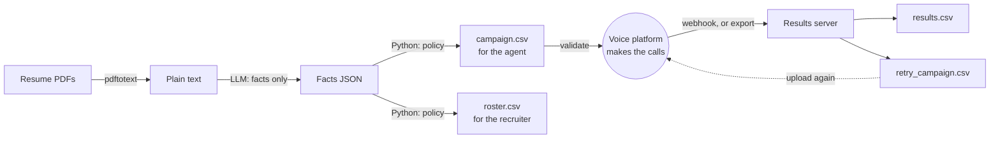

# resume-screener

The data plumbing around an AI phone-screening agent.

A voice agent that screens job applicants is the visible part. This is the part
around it: turning a folder of resume PDFs into a call sheet the agent can read
from, checking that sheet before anyone is dialled, catching the results when
each call ends, and working out who still needs to be called again.

It works with any voice platform that can read a CSV of contacts and send a
webhook when a call finishes.



## Quickstart

Needs Python 3.10+ and poppler (`apt install poppler-utils` or `brew install poppler`).

```bash
git clone https://github.com/defnotutkarsh/resume-screener && cd resume-screener
python -m venv .venv && source .venv/bin/activate
pip install -e ".[dev]"
pytest            # everything runs offline, on made-up resumes
```

Then try the pipeline on the made-up resumes in `tests/fixtures/`:

```bash
mkdir -p resumes
for f in tests/fixtures/resumes/*.txt; do
  resume-screener make-pdf "$f" "resumes/$(basename "${f%.txt}").pdf"
done

cp .env.example .env                 # add your GEMINI_API_KEY
resume-screener build --job examples/job.example.json --text-only   # free: no API calls
resume-screener build --job examples/job.example.json
resume-screener validate --prompts examples/prompts
```

And the results side:

```bash
resume-screener serve --job examples/job.example.json
# in another terminal:
curl -X POST localhost:8086/post-call -H 'content-type: application/json' \
     -d @examples/webhook_payload.example.json
cat out/results.csv
```

## Commands

| Command | What it does |
|---|---|
| `build` | Resume PDFs → `out/campaign_*.csv` and `out/roster_*.csv`. `--text-only` shows what was readable without spending anything; results are cached by content hash, so a second run is free |
| `validate` | Checks a campaign CSV: phone format, duplicates, and whether it fills every `{{variable}}` the agent's prompt speaks |
| `serve` | Receives the post-call webhook, saves each call, rebuilds `results.csv` and `retry_campaign.csv` |
| `backfill` | Imports calls from a JSON/JSONL export, for webhooks that were missed |
| `rebuild` | Rebuilds both CSVs from the calls already on disk |
| `refetch` | Retries transcript downloads that failed |
| `make-pdf` | Turns a text file into a real PDF, for testing without anyone's actual resume |

## Design decisions

Each of these is here because the simpler version went wrong on real calls.

**The model extracts facts. Python decides policy.** The model is never told who
is eligible; it only records what the resume says. Every flag is computed in
[`policy.py`](src/resume_screener/policy.py). Change the job's rules and you
re-run the policy over cached facts. You never re-parse and never pay twice, and
a rule can be read and tested like any other code.

**Phone numbers are normalised in code, never by the model.** That one field
decides who gets dialled. A plausible guess there rings a stranger.

**"Unknown" is a real answer.** Yes/no facts are three-valued strings
(`true`/`false`/`unknown`), not booleans. A boolean has no room for "the resume
does not say", and a missing key quietly reads as `false`, which fails people
the resume never spoke about.

**The model has no clock.** "March 2024 – Present" was once measured against
whatever date the model assumed, which gave six months of experience where the
right answer was thirty-four. Nothing errored; the number just looked
plausible. Today's date is now injected into every prompt, and a test pins it.

**Flags are recorded, never acted on.** Everyone with a phone number is called.
A resume is a snapshot: people move, finish degrees, change their minds. The
call is the source of truth; the flags only help a recruiter sort afterwards.

**Two files, two audiences.** `campaign.csv` is what the agent may see.
`roster.csv` is what the recruiter reads, including candidates with no usable
number and fields (like the flags) the agent must never be handed.

**Check coverage, not just format.** A dialler will accept a CSV whose
`probe_line` column is empty in a fifth of the rows. The mistake only shows up
as a wrong sentence on a live call. The validator reads the prompt files and
checks the CSV against what the agent will actually say.

**A call that did not happen is not a rejection.** Voicemail, a relative
answering, "call me tomorrow" and "not interested" are four different endings,
and only the last is final. [`retry.py`](src/resume_screener/retry.py) holds
that decision. Unknown outcome words are retried, not dropped.

**Rebuild, never append.** Webhook senders retry, so the same call can arrive
three times. Both CSVs are rebuilt from the saved call files on every delivery,
which makes a repeat harmless.

**Always build the pull path too.** If the webhook fires while the receiver is
down, a whole batch can vanish without a single error. `backfill` reads the
same calls from an export, so the webhook is never the only copy of anything.

**Short calls are not scored.** A twelve-second call with a silent candidate
can come back "shortlist", because a model asked to fill a rubric will fill
it. Below a minimum duration the rubric is discarded. Totals are also re-added
from their parts, so the model's arithmetic never reaches a recruiter.

**Text from a resume is data, not instructions.** A candidate writes their own
resume, so a line can be shaped like a command. Values are flattened and
truncated here, and the agent's prompt must quote them as data
(see [the example prompt](examples/prompts/screening_call.example.txt)).

## Connecting a voice platform

The results side reads one normalised record per call
([`adapters/base.py`](src/resume_screener/adapters/base.py)). The built-in
adapter accepts a plain JSON webhook like
[`examples/webhook_payload.example.json`](examples/webhook_payload.example.json):

| Field | Meaning |
|---|---|
| `run_id` | Unique id of the call |
| `call_time`, `duration_seconds`, `disposition` | When, how long, and the platform's status word |
| `transcript` or `transcript_url` | The text inline, or where to fetch it |
| `initial_context` | The CSV row the call was given |
| `gathered_context` | What the call produced. `call_outcome` drives the retry list |

If your platform's payload looks different, write one `normalize(payload)`
function and pass it to `ResultsStore(adapter=...)`. Nothing else changes.

## Security notes

- The server binds to `127.0.0.1` unless you pass `--host`.
- Set `WEBHOOK_SECRET` and the server rejects any request without a matching
  `X-Webhook-Secret` header.
- Transcript URLs are only fetched from hosts listed in `TRANSCRIPT_HOSTS`.
  Otherwise anyone who can post to the server could make it request internal
  addresses.
- `resumes/` and `out/` are gitignored. Resumes are personal data: keep them
  off GitHub, and delete them when the hiring round ends.

## What is not here

- **No OCR.** A scanned or photographed resume yields no text. It lands in the
  roster flagged `unreadable` and is left out of the dial file.
- **No dialler and no voice agent.** This is the pipeline around them.
- **Phone numbers are Indian mobiles only.** It is one function in
  [`phone.py`](src/resume_screener/phone.py).
- **The live-model tests need a key.** `pytest -m live` runs the real model
  against the fixture resumes; without `GEMINI_API_KEY` they are skipped.

Every name, company, phone number and resume in this repository is made up.
The phone numbers are placeholders; do not dial them.

## License

MIT
